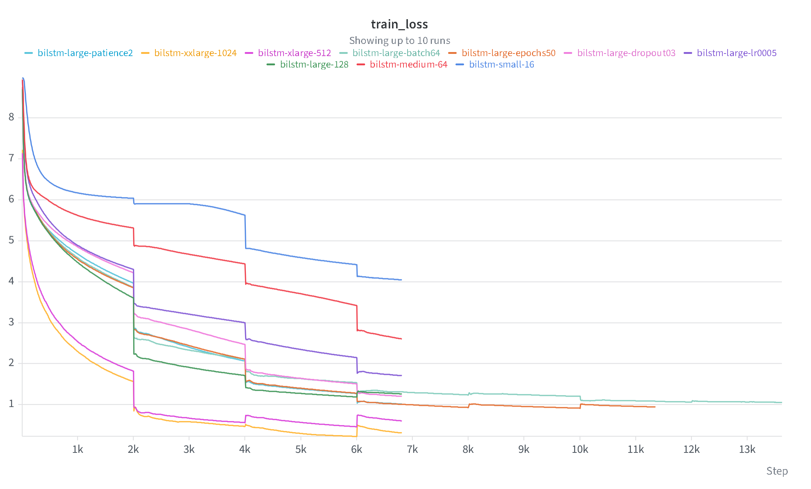
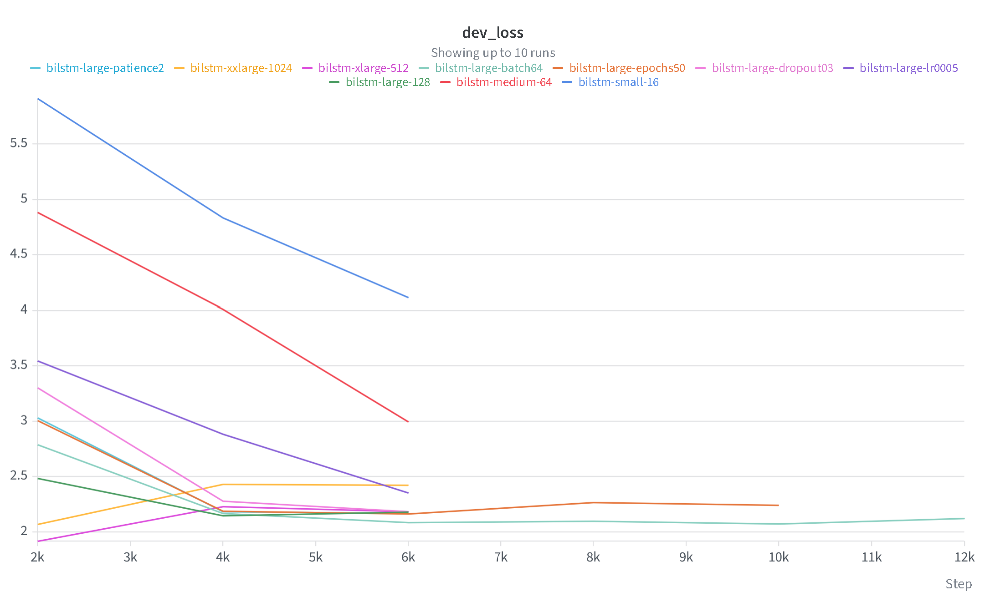

# Part I: Global Attention for a Bi-LSTM seq2seq Model 

## 1. Implementing Dot-Product Attention

The first task was to implement the dot-product global attention mechanism in the step() method of the NMT class in nmt_model.py.

The encoder processes the English input sentence in both directions, producing hidden representations that contain information about the words and their surrounding context. The decoder then generates the German translation one word at a time.

Without attention, a decoder would have to rely heavily on a fixed representation of the input sentence. This can make translation difficult, particularly for longer sentences where important information may be lost. Attention addresses this by allowing the decoder to access different encoder hidden states at each decoding step.

### Calculating Attention Scores

At each decoding step, we first compare the current decoder hidden state with the hidden states produced by the encoder using dot-product attention, which calculates a similarity score between the decoder state and each encoder state. A larger score suggests that a particular source position is more relevant to the word currently being generated.

Since the encoder is bidirectional, its output contains information from both forward and backward passes.

### Normalising Attention Scores

The attention scores are then passed through a softmax function, converting them into attention weights.

These weights sum to one and determine how much importance the decoder assigns to each source position. Padding positions are masked so that they do not receive attention, since they do not represent actual words in the input sentence.

### Computing the Context Vector

Next, we calculate a context vector by taking the weighted sum of the encoder hidden states.

This context vector summarises the parts of the English sentence that are most relevant to the current decoding step. Rather than treating every input word equally, the model can place greater emphasis on the words needed to generate the next German word.

### Producing the Attentional Hidden State

Finally, the context vector is combined with the decoder hidden state. The combined representation is passed through a linear transformation and a non-linear activation to produce the attentional hidden state.

This representation is used by the decoder to predict the next target word.

After implementing these operations, we ran sanity_check.py to verify that the attention mechanism produced outputs with the expected dimensions and behaviour. The sanity checks passed, allowing us to proceed with training.

## 2. Initial Model Training

After completing the attention mechanism, we trained three Bi-LSTM models using the Multi30k English-to-German dataset.

The dataset contained 29,000 training sentence pairs, 1,014 validation pairs, and 1,000 test pairs.

We initially tested three embedding and hidden-state sizes: 16, 64, and 128. All other settings were kept the same, including a learning rate of 0.001, dropout of 0.2, batch size of 128, and a maximum of 30 epochs.

Training was performed using CUDA on an NVIDIA RTX 3050 Ti Laptop GPU. We used Weights & Biases (W&B) to monitor training loss, validation loss, and learning-rate changes. The graphs from this were downloaded as CSVs in ./wandbRESULTS_GRAPHS, with the final train and dev loss for all models captured also as screenshots from W&B's dashboard.

The small model achieved only 1.63 BLEU and frequently generated repetitive or incorrect translations. Increasing the dimensions to 64 improved BLEU to 12.40, while the 128-dimensional model achieved 30.74. Thus the 128-dimensional model became our baseline.

Training and validation losses also generally decreased as model size increased, suggesting that the larger models had enough capacity to learn more useful word representations and translation patterns.

However, the 128-dimensional model's validation loss began to plateau even while training loss continued decreasing. This suggested that further training might not necessarily improve performance on unseen sentences.

## 3. Hyperparameter Tuning

After establishing the three baseline models, we carried out additional experiments to investigate whether translation performance could be improved.

### 3.1 Learning Rate

We reduced the initial learning rate from 0.001 to 0.0005 while keeping the 128-dimensional architecture unchanged.

BLEU decreased from 30.74 to 25.33, and validation loss was also higher. A possible explanation is that the smaller learning rate produced slower parameter updates, preventing the model from converging as effectively within 30 epochs.

### 3.2 Dropout

We increased dropout from 0.2 to 0.3 to investigate whether stronger regularisation would improve generalisation.

The model achieved 30.94 BLEU, slightly higher than the baseline's 30.74. However, its best validation loss was marginally worse.

This shows that lower validation loss does not always correspond to higher BLEU, since the two metrics measure different aspects of model performance. The improvement was also too small to establish a reliable advantage from a single experiment.

### 3.3 Training Duration

We increased the maximum training duration from 30 to 50 epochs.

Training loss continued decreasing, but validation loss began increasing after reaching its minimum. The resulting BLEU score was 30.45, slightly below the original baseline.

This suggests that additional training mainly improved the model's fit to the training examples rather than its ability to translate unseen sentences, indicating possible overfitting.

### 3.4 Batch Size

We reduced the training batch size from 128 to 64.

This improved BLEU to 31.56 and produced a lower validation loss than the original large model.

With a smaller batch size, the model performs more parameter updates per epoch, which may help optimisation. However, because this also changes the number of updates and the timing of validation checks, the improvement cannot be attributed entirely to batch size alone.

### 3.5 X-Large Architecture — 512 Dimensions

We then increased both the embedding and hidden-state dimensions to 512.

This model achieved **33.79 BLEU**, the highest score across all experiments, along with the lowest recorded validation loss of 1.9171.

The larger architecture likely benefited from its greater capacity to represent words and capture complex translation relationships. However, validation loss increased after its first recorded minimum while training loss continued decreasing, suggesting that the model also began to overfit.

### 3.6 XX-Large Architecture — 1024 Dimensions

We further increased both dimensions to 1024 to investigate whether additional capacity would improve performance.

Instead, BLEU decreased to 30.05. Training loss continued falling, but validation loss increased substantially after the first validation check.

This suggests that the additional model capacity was not beneficial under the available dataset and training configuration. The model may have become more prone to overfitting, demonstrating that increasing model size does not always improve translation quality.

### 3.7 Early-Stopping Patience

Finally, we returned to the 128-dimensional model and increased the patience setting from 1 to 2.

This allowed more unsuccessful validation checks before the training procedure would reduce the learning rate.

The model achieved 31.07 BLEU, slightly outperforming the original baseline. Its learning rate remained unchanged throughout training, suggesting that the increased patience delayed learning-rate reductions. However, the small improvement does not establish that the new setting is consistently better.

## 4. Evaluation and Model Comparison

All models were evaluated on the same 1,000 test sentence pairs using corpus-level BLEU.

| Model | Embed / Hidden | LR | Dropout | Batch | Epochs | Patience | Best dev loss | BLEU |
|---|---|---:|---:|---:|---:|---:|---:|---:|
| Small | 16 / 16 | 0.001 | 0.2 | 128 | 30 | 1 | 4.1135 | 1.63 |
| Medium | 64 / 64 | 0.001 | 0.2 | 128 | 30 | 1 | 2.9956 | 12.40 |
| Large baseline | 128 / 128 | 0.001 | 0.2 | 128 | 30 | 1 | 2.1466 | 30.74 |
| Large - reduced LR | 128 / 128 | 0.0005 | 0.2 | 128 | 30 | 1 | 2.3518 | 25.33 |
| Large - dropout 0.3 | 128 / 128 | 0.001 | 0.3 | 128 | 30 | 1 | 2.1840 | 30.94 |
| Large - 50 epochs | 128 / 128 | 0.001 | 0.2 | 128 | 50 | 1 | 2.1645 | 30.45 |
| Large - batch 64 | 128 / 128 | 0.001 | 0.2 | 64 | 30 | 1 | 2.0742 | 31.56 |
| Large - patience 2 | 128 / 128 | 0.001 | 0.2 | 128 | 30 | 2 | 2.1678 | 31.07 |
| X-large | 512 / 512 | 0.001 | 0.2 | 128 | 30 | 1 | **1.9171** | **33.79** |
| XX-large | 1024 / 1024 | 0.001 | 0.2 | 128 | 30 | 1 | 2.0694 | 30.05 |

BLEU measures the overlap between generated translations and reference translations using word sequences of different lengths. A higher BLEU score generally indicates better agreement with the references, although it does not directly measure whether a translation preserves the correct meaning.

The results showed that increasing the embedding and hidden-state dimensions improved performance substantially up to 512 dimensions. Beyond this point, performance decreased.

Among the training hyperparameters, reducing batch size produced the largest improvement for the 128-dimensional architecture, while reducing the learning rate caused the largest decrease.

The 512-dimensional model achieved the strongest overall result, with 33.79 BLEU and a best validation loss of 1.9171.

## 5. Observations and Limitations

Inspecting the generated translations helped explain the differences between models.

The smaller models frequently produced repetitive phrases, unknown tokens, and incorrect grammar. Larger models generally generated more coherent sentences and preserved more of the original meaning.

However, even the better-performing models sometimes selected incorrect nouns, repeated words, or changed the subject of a sentence. This demonstrates that a relatively high BLEU score does not guarantee that every translation is semantically correct.

Several experiments also showed decreasing training loss alongside increasing validation loss. This is consistent with overfitting, where a model becomes better at fitting its training examples without improving on unseen data.

Additionally, each configuration was trained only once, so small performance differences may partly reflect variation between training runs. The experiments also used greedy decoding, which selects the most probable word at each step without necessarily finding the best complete translation.

## 6. Conclusion

The implementation of dot-product attention allowed the Bi-LSTM decoder to use information from different parts of the source sentence when generating translations.

The experiments showed that increasing model capacity significantly improved translation quality, but only up to a certain point. The 512-dimensional model achieved the highest BLEU score of **33.79**, while the larger 1024-dimensional model performed worse.

Hyperparameter tuning also demonstrated that learning rate, dropout, batch size, training duration, and patience can affect model performance. Overall, the results highlight the importance of balancing model capacity and training settings while monitoring validation performance to identify overfitting.

## CANVAS QnA

### a.

| Model | Embedding | Hidden | LR | Dropout | Batch | Best dev loss | BLEU |
|---|---:|---:|---:|---:|---:|---:|---:|
| Small | 16 | 16 | 0.001 | 0.2 | 128 | 4.1135 | 1.63 |
| Medium | 64 | 64 | 0.001 | 0.2 | 128 | 2.9956 | 12.40 |
| Large | 128 | 128 | 0.001 | 0.2 | 128 | 2.1466 | 30.74 |
| Large - reduced LR | 128 | 128 | 0.0005 | 0.2 | 128 | 2.3518 | 25.33 |
| Large - increased dropout | 128 | 128 | 0.001 | 0.3 | 128 | 2.1840 | 30.94 |
| Large - smaller batch | 128 | 128 | 0.001 | 0.2 | 64 | 2.0742 | 31.56 |
| X-large | 512 | 512 | 0.001 | 0.2 | 128 | **1.9171** | **33.79** |
| XX-large | 1024 | 1024 | 0.001 | 0.2 | 128 | 2.0694 | 30.05 |

### b.

### c.

Short Discussion:

The experimental results demonstrate that model capacity significantly influences translation quality. 
Increasing the embedding and hidden-state dimensions from 16 to 512 improved BLEU from 1.63 to 33.79, 
suggesting that larger representations capture more complex linguistic relationships. However, further 
increasing both dimensions to 1024 reduced BLEU to 30.05, accompanied by increasing validation loss 
despite decreasing training loss, suggesting overfitting and diminishing returns.

Hyperparameter tuning also affected performance. Reducing the learning rate from 0.001 to 0.0005 decreased 
BLEU from 30.74 to 25.33, potentially due to slower convergence within the fixed training budget. 
Increasing dropout from 0.2 to 0.3 marginally improved BLEU to 30.94, although the difference was small. 
Reducing batch size from 128 to 64 achieved 31.56 BLEU, potentially benefiting from more frequent 
parameter updates, although this also changes the optimisation schedule.

Overall, the 512-dimensional model achieved the highest BLEU score (33.79) and lowest validation 
loss (1.9171), providing the strongest performance among the evaluated configurations. These findings 
highlight the importance of balancing model capacity, optimisation and generalisation 
rather than assuming that larger models or longer training always improve translation quality.

